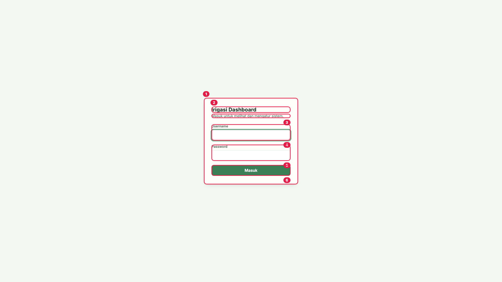
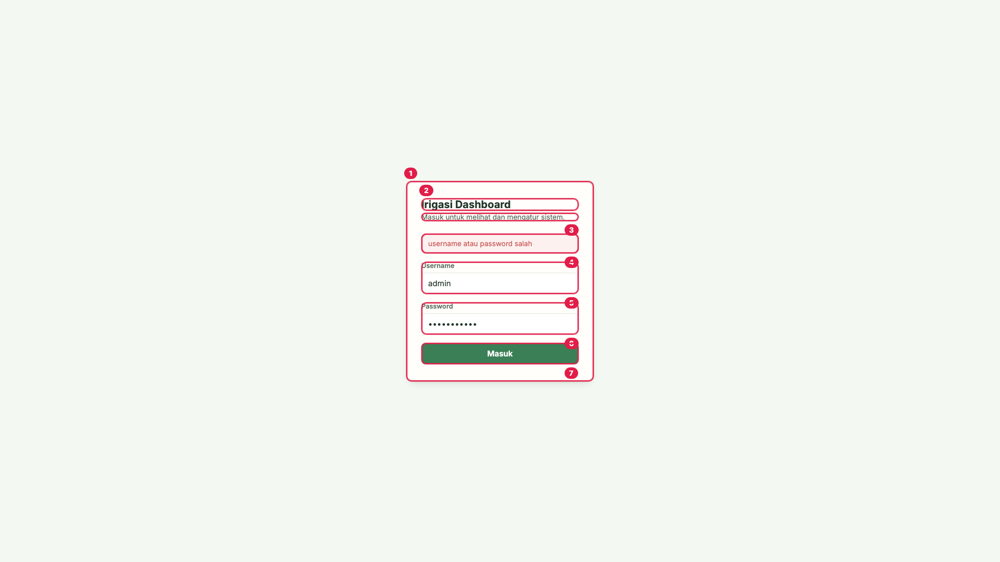
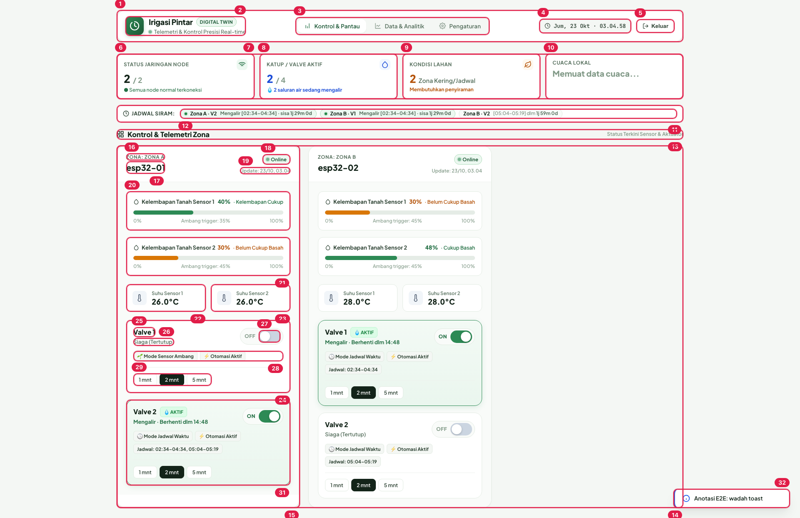
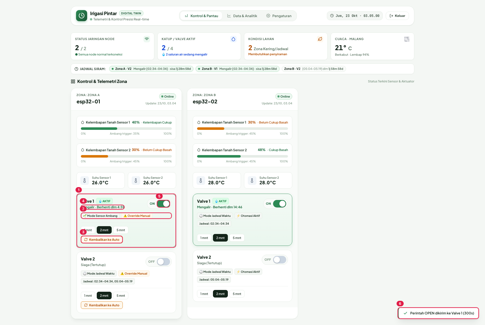
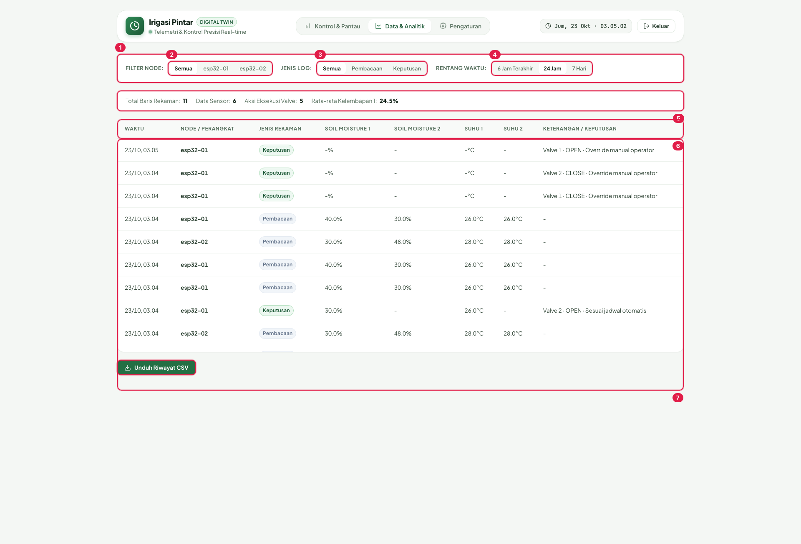
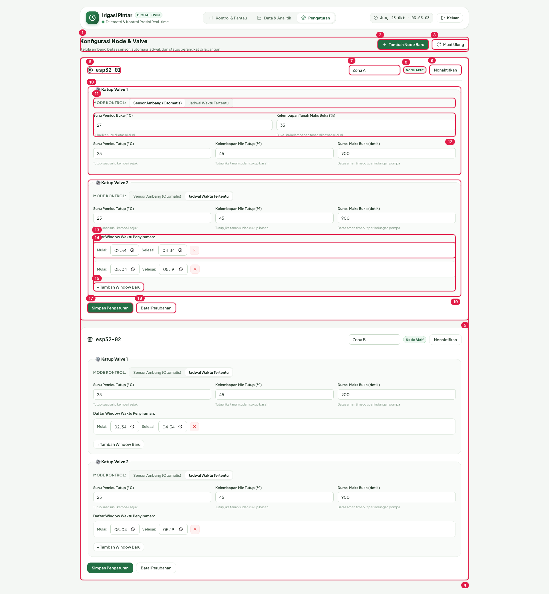
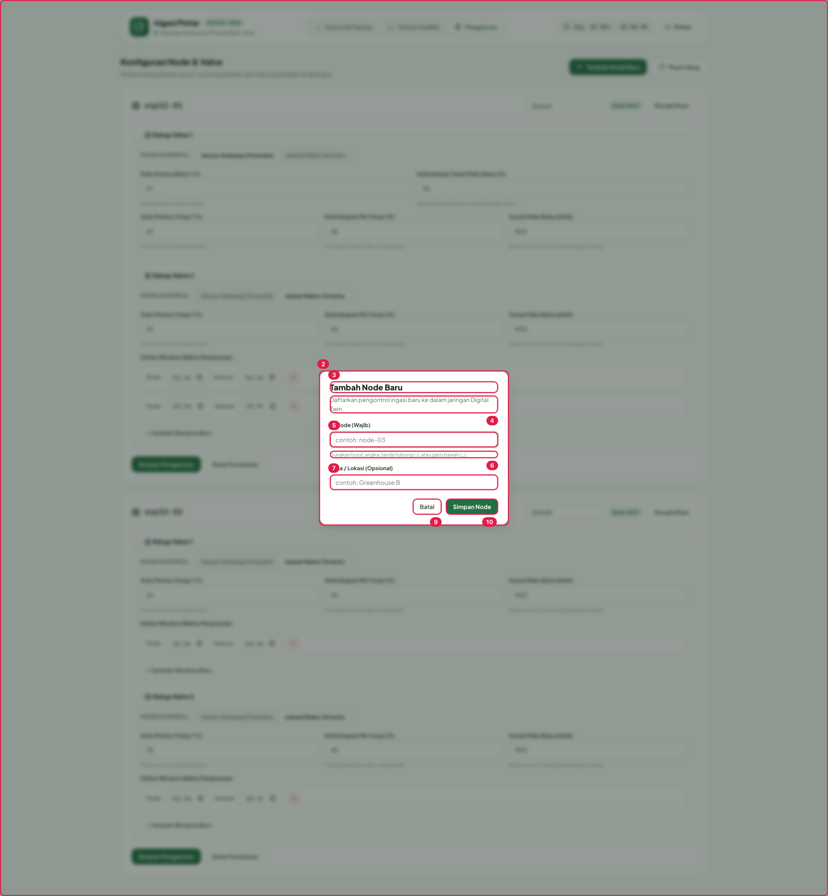
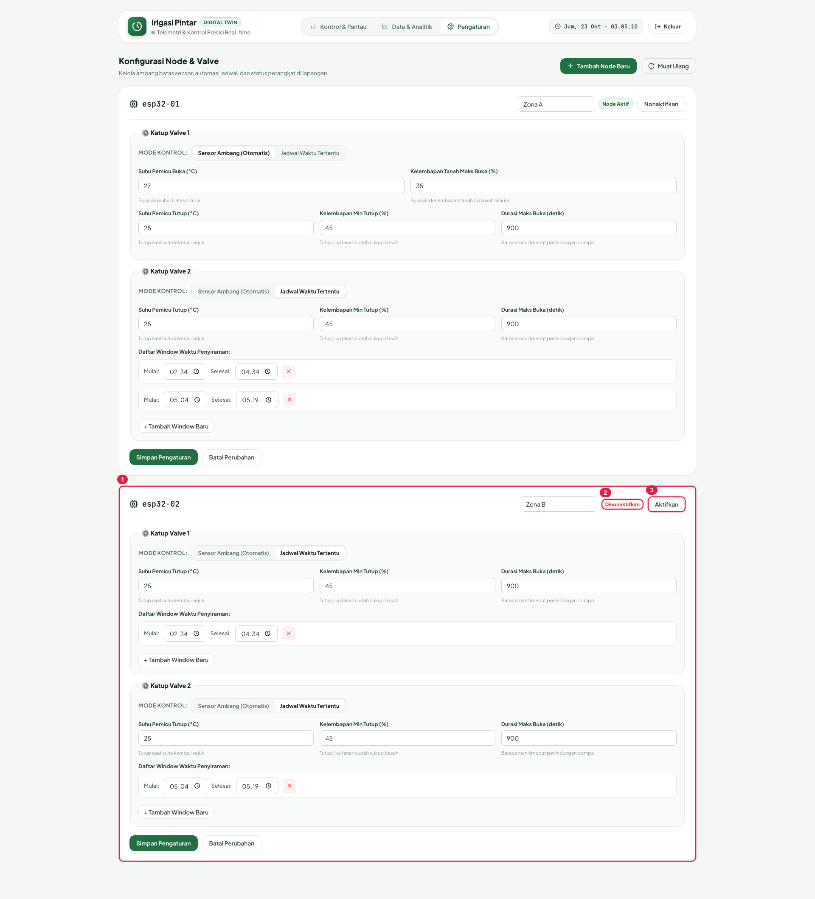
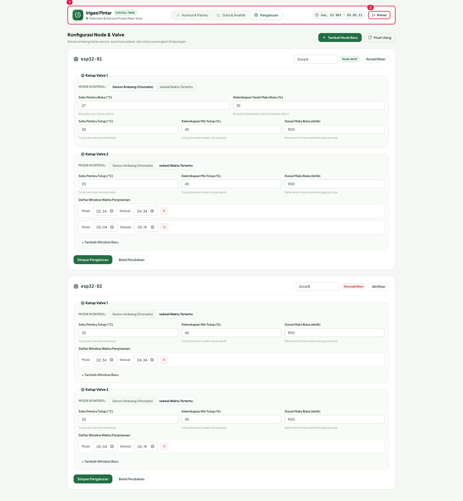

# Buku Manual — Dashboard Irigasi Digital Twin (`irigasi-core`)

> Panduan ini disusun untuk operator/admin berdasarkan kode aplikasi, perilaku yang
> diuji, dan hasil uji fungsional (38/38 PASSED, `docs/report.md`). Nomor pada setiap
> gambar adalah kotak batas (bounding box) yang disuntik `tests/e2e/annotate.mjs`
> melalui Playwright — bagian §3 merinci tiap nomor tersebut lengkap dengan fungsi,
> endpoint, dan komponen kodenya.

---

## Ringkasan

### Apa ini

Dashboard web untuk **digital twin irigasi**: menampilkan kondisi nyata node lapangan
(telemetri kelembapan tanah + suhu), mengendalikan katup (buka/tutup) secara manual, dan
mengatur otomasi (berbasis sensor atau jadwal waktu). Dibangun dengan axum 0.7
(`src/dashboard/mod.rs:7`) dan antarmuka satu halaman (`static/index.html`) dengan tiga tab:
**Kontrol & Pantau**, **Data & Analitik**, **Pengaturan**.

### Siapa yang memakai

Satu peran: **operator/admin**. Tidak ada multi-user. Login sekali (`admin` / `admin123`,
`src/dashboard/auth.rs:18-19`), sesi bertahan **24 jam** (cookie `irigasi_session`) dan
hilang saat layanan di-restart (token sesi disimpan hanya di memori,
`src/dashboard/state.rs:11`).

### Bagaimana sistem bekerja (alur singkat)

```
Node ESP32 di lapangan ──MQTT publish `irigasi/ipesg/v1/<device_id>/sensor`──▶ Server
                                                       Server ──state twin──▶ Dashboard
Operator klik buka/tutup katup ──API──▶ Server ──MQTT publish `.../<device_id>/command`──▶ Perangkat
```

- Telemetri masuk lewat topik `irigasi/ipesg/v1/+/sensor` (`src/mqtt/topics.rs`).
- Publikasi perintah **hanya** mengubah state valve bila MQTT memang sukses
  (`src/dashboard/routes.rs:252-277`). Bila broker mati, API tetap 200 dengan
  `{"published": false}` dan UI tidak berubah — sinyal bahwa perintah tidak terkirim.

---

## Panduan Langkah demi Langkah

### Langkah 0 — Masuk

Buka alamat dashboard. Tanpa sesi, `GET /` mengalihkan (302) ke `/login`
(`src/dashboard/auth.rs:88-108`).



1. Ketik **Username** (4) dan **Password** (5).
2. Klik **[6] Masuk**. Berhasil → cookie `irigasi_session` terpasang dan masuk dashboard
   (`static/login.html:88`). Gagal → muncul **banner error** "username atau password salah":



Banner error (kotak 4) tampil, sementara tombol Masuk (kotak 7) kembali normal — cukup
coba lagi; halaman tidak berpindah (`static/login.html:91-98`).

### Langkah 1 — Baca kondisi sistem (tab "Kontrol & Pantau")



Baca urut dari atas:

- **Baris KPI (6–10)**: status jaringan node, katup aktif, kondisi lahan, cuaca Malang
  (data cuaca diambil front-end dari Open-Meteo, `static/index.html:1700`).
- **Widget "Jadwal Siram" (11–12)**: item jadwal mode-waktu yang sedang `Mengalir` atau
  pesan mode sensor (dari `GET /api/schedule/active`).
- **Kartu node (14–23)**: satu kartu per node; zona, ID, pill Online (status dihitung dari
  `last_reading_at` ≤ 30 detik, `src/dashboard/routes.rs:75`), gauge kelembapan dua sensor,
  tile suhu.
- **Kartu valve (24–31)**: dua valve per node; setiap kartu punya switch ON/OFF, badge mode,
  dan pemilih durasi.

Dashboard memuat ulang data **setiap 4 detik** (polling, `static/index.html:1697`),
jadi angka menyegarkan sendiri — tidak perlu memuat ulang halaman.

### Langkah 2 — Buka/tutup valve secara manual (override)



1. Pada kartu valve tujuan, pilih dulu **durasi** di chip durasi (1 mnt / 2 mnt / 5 mnt):
   chip hanya mengubah tampilan, durasi terkirim saat tombol aksi ditekan
   (`static/index.html:2003, 2015-2016`). Tanpa memilih chip → default 2 mnt.
2. Tekan switch (kotak 5) → `POST /api/nodes/<id>/command`
   `{ action: "open", duration_s }` (`src/dashboard/routes.rs:160`).
3. Toast sukses muncul: `Perintah OPEN dikirim ke Valve 1 (300s)` (kotak 6).
4. Kartu berubah: **badge "⚠️ Override Manual"** mengganti "⚡ Otomasi Aktif" dan tombol
   **"Kembalikan ke Auto"** muncul (kotak 3) — bukti valve di bawah kendali Anda.
5. Menutup valve (tutup switch) **tidak melepas** override — badge manual tetap karena
   sumber tetap `manual` (`src/twin/mod.rs:116`); dua langkah berikutnya melepasnya:
   - klik **"Kembalikan ke Auto"** → `POST /api/nodes/<id>/valves/<n>/release`
     (`src/dashboard/routes.rs:196`), atau
   - tunggu kedaluwarsa (`expires_at = now + duration_s`).

### Langkah 3 — Cek riwayat & unduh CSV (tab "Data & Analitik")



- Filter **node** (kotak 2), **jenis log** Pembacaan/Keputusan (kotak 3), dan **rentang**
  (kotak 4). Statistik ringkas (kotak 5) mengikuti filter aktif.
- Tabel (kotak 6–7) menggabungkan readings dan decisions hingga 200 baris tampil dari
  data yang diambil per node (limit 300 per endpoint, `static/index.html:2121-2173`).
- **Unduh Riwayat CSV** (kotak 8) mengunduh hasil **terfilter** (bukan seluruh DB), nama
  berkas `irigasi_<node>_<range>jam.csv` dengan BOM UTF-8 (`static/index.html:2184`).

### Langkah 4 — Atur konfigurasi node (tab "Pengaturan")



Saat halaman dibuka, seluruh konfigurasi dimuat via `GET /api/settings`
(`static/index.html:1418`). Per node (kartu esp32-01 pada gambar):

1. **Zona** (kotak 7): teks bebas; kosong → node berlabel "ZONA UMUM".
2. Di dalam setiap **fieldset valve** (kotak 10 untuk Valve 1; Valve 2 mirip, kotak 19):
   - **Mode kontrol** (kotak 11): pilih *Sensor Ambang (Otomatis)* atau *Jadwal Waktu
     Tertentu*. Mengganti formulir yang tampil saja, belum tersimpan
     (`static/index.html:2286-2331`).
   - Mode sensor → isi ambang buka/tutup (kotak 12). Histeresis wajib:
     `open_temp_threshold_c >= close_temp_threshold_c` dan `open_soil_max_pct <=
     close_soil_min_pct` (`src/config.rs:100`).
   - Mode jadwal → atur baris window (kotak 14), tambah window (kotak 15). Maks 12 window,
     mulai < selesai, tidak boleh melewati tengah malam / tumpang tindih / duplikat.
3. **Simpan Pengaturan** (kotak 17) → `PUT /api/nodes/<id>/config` (kedua valve wajib
   dikirim). Validasi berjalan dua lapis (client, `static/index.html:2463-2490`, pesan
   berawalan "Validasi: "; server, `src/config.rs:100`).
4. **Batal Perubahan** (kotak 18) menimpa kartu dengan snapshot server — semua perubahan
   di kartu dibuang (`static/index.html:2381-2385`).

### Langkah 5 — Daftarkan node baru

Klik "Tambah Node Baru" (kotak 2 pada Langkah 4) → modal terbuka dalam keadaan bersih:



1. Isi **ID Node** (kotak 5): wajib, ≤ 64 karakter, hanya `A-Z a-z 0-9 _ -`
   (validasi di server, `src/dashboard/routes.rs:397`).
2. **Zona** (kotak 7) opsional.
3. **Simpan Node** (kotak 10) → `POST /api/nodes`; sukses `201` dan node langsung muncul
   (ID duplikat ditolak server dengan 409: "node &lt;id&gt; sudah ada").
   ID kosong/format salah ditolak dengan banner (kotak 8).

### Langkah 6 — Nonaktifkan/aktifkan node



- Tombol **Nonaktifkan** (pada Pengaturan, kotak 9 di Langkah 4) menolak bila valve masih
  terbuka: `"valve 1 masih terbuka, tutup dulu sebelum menonaktifkan node"`
  (`src/dashboard/routes.rs:432-438`). Sukses → kartu berubah seperti gambar di atas:
  pill "Dinonaktifkan" (kotak 2) + tombol "Aktifkan" (kotak 3).
- Efek lintas halaman: node nonaktif **hilang dari Kontrol** tapi **tetap tampil** di chip
  filter Data & Analitik (halaman data memakai `include_disabled=true`).
- **Aktifkan** → node kembali normal, tanpa syarat valve (`routes.rs:191-194`).

### Langkah 7 — Keluar



Klik **Keluar** (kotak 2) di kanan atas. Browser menampilkan dialog konfirmasi bawaan
(`confirm()` native, bukan bagian halaman, sehingga tidak ikut difoto): bila OK →
`POST /api/logout` → kembali ke `/login` (`static/index.html:2550`). Bila Batal → tetap
di dashboard, tanpa request apapun.

---

## Rincian Fitur — Penjelasan Tiap Kotak Bernomor

### Gambar `01-login` & `02-login-error` (`static/login.html`)

| # | Kotak | Fungsi & endpoint | Komponen |
|---|-------|-------------------|----------|
| 1 | Kartu login | Wadah form | `login.html:28` |
| 2 | Judul "Irigasi Dashboard" | Identitas aplikasi | `login.html:55` |
| 3 | Subtitle | Instruksi singkat | `login.html:56` |
| 4 | Banner error (tersembunyi di 01, tampil di 02) | "username atau password salah" bila `POST /api/login` ditolak | `login.html:57, 91-98` |
| 5 | Input Username | `autofocus`, `autocomplete=username` | `login.html:59-60` |
| 6 | Input Password | `type=password` | `login.html:61-62` |
| 7 | Tombol Masuk | Submit → `POST /api/login` → cookie `irigasi_session`; saat memproses label jadi "Memeriksa…" | `login.html:63, 76-88` |

### Gambar `03-control` (`static/index.html`, halaman Kontrol & Pantau)

| # | Kotak | Fungsi & endpoint | Komponen |
|---|-------|-------------------|----------|
| 1 | Topbar | Bar atas sticky | `index.html:1281` |
| 2 | Brand group | Logo + judul | `index.html:1282` |
| 3 | Nav tabs | Tiga tab; berganti state tanpa ganti URL | `index.html:1301, 1572` |
| 4 | Jam lokal | Tick 1 detik, format `id-ID` | `index.html:1317, 1584` |
| 5 | Tombol Keluar | `confirm()` → `POST /api/logout` | `index.html:1321, 2550` |
| 6 | Grid KPI | Re-render penuh tiap 4 detik | `index.html:1331, 1697` |
| 7 | KPI Status Jaringan | `online/total`; amber bila offline/valve terbuka | `index.html:1643` |
| 8 | KPI Katup aktif | `terbuka/total`; biru bila > 0 | `index.html:1661` |
| 9 | KPI Kondisi Lahan | Zona kering/jadwal; amber bila > 0; rumus `index.html:1630-1640` | `index.html:1679` |
| 10 | KPI Cuaca | Open-Meteo (front-end) | `index.html:1700` |
| 11 | Widget Jadwal Siram | Data `GET /api/schedule/active` | `index.html:1336` |
| 12 | Baris jadwal | `Mengalir [win] · sisa X` / `[win] dlm X` / pesan mode sensor | `index.html:1343, 1752` |
| 13 | Judul seksi node | Kosmetik | `index.html:1349` |
| 14 | Grid kartu node | Data `GET /api/nodes` | `index.html:1358` |
| 15 | Kartu node | Kontainer telemetri+valve | `index.html:1948` |
| 16 | Tag zona | `ZONA: <nama>` atau `ZONA UMUM` | `index.html:1951` |
| 17 | ID node | `device_id` | `index.html:1952` |
| 18 | Pill Online/Offline | < 30 detik sejak `last_reading_at` | `index.html:1943`, `routes.rs:75` |
| 19 | Waktu update | `fmtTime(last_reading_at)` | `index.html:1956` |
| 20 | Gauge Soil 1 | Persen + bar + ambang; arah ambang mode-sensor `open_soil_max_pct` vs mode-schedule `close_soil_min_pct` | `index.html:1962, 1789, 1801-1824` |
| 21 | Gauge Soil 2 | Sama, sensor kedua | `index.html:1963` |
| 22-23 | Tile suhu 1/2 | `last_temp_N_c` + °C | `index.html:1973, 1983` |
| 24 | Kartu Valve 1 | Kontainer aktuator | `index.html:1877` |
| 25 | Judul + badge AKTIF | `💧 AKTIF` bila open | `index.html:1881` |
| 26 | Status aliran | `Mengalir · Berhenti dlm M:SS` / `Siaga (Tertutup)` | `index.html:1884` |
| 27 | Switch buka/tutup | `POST /api/nodes/<id>/command`; `data-device`+`data-valve` pada kartu; tombol `disabled` selama request (anti klik-cepat) | `index.html:1891, 2011-2049` |
| 28 | Badge mode | "Mode Jadwal Waktu"/"Mode Sensor Ambang" + "⚡ Otomasi Aktif"/"⚠️ Override Manual" | `index.html:1895-1899` |
| 29 | Pemilih durasi | Chip 1 mnt/2 mnt(default)/5 mnt; nilainya dibaca saat tombol ditekan | `index.html:1906, 2003, 2015-2016` |
| 30 | Tombol "Kembalikan ke Auto" | Hanya dirender bila `source === 'manual'`; `POST /api/nodes/<id>/valves/<n>/release` | `index.html:1914`, `routes.rs:196` |
| 31 | Kartu Valve 2 | Identik struktur untuk valve 2 | `index.html:1888` |
| 32 | Wadah toast | `showToast()`; auto 3500 ms + fade 300 | `index.html:1452, 1502, 1519` |

### Gambar `04-valve-manual` (delta override manual)

| # | Kotak | Fungsi | Komponen |
|---|-------|--------|----------|
| 1 | Kartu Valve 1 manual | kelas `.is-open` | `index.html:1877` |
| 2 | Badge "⚠️ Override Manual" | kelas `.micro-badge.manual-held` | `index.html:1899` |
| 3 | "Kembalikan ke Auto" | lepas override | `index.html:1914` |
| 4 | Status aliran `.is-active` | "Mengalir · Berhenti dlm M:SS" | `index.html:1884` |
| 5 | Switch (posisi ON) | tutup → `action: "close"` (override dipertahankan) | `index.html:1891`, `src/twin/mod.rs:116` |
| 6 | Toast sukses | "Perintah OPEN dikirim ke Valve 1 (300s)" | `index.html:2038-2048` |

### Gambar `05-data` (halaman Data & Analitik)

| # | Kotak | Fungsi & endpoint | Komponen |
|---|-------|-------------------|----------|
| 1 | Kartu filter | Wadah 3 grup filter | `index.html:1363` |
| 2 | Filter node | `Semua` + chip per node (termasuk nonaktif, dari `/api/nodes?include_disabled=true`) | `index.html:1366, 2081` |
| 3 | Filter jenis log | Semua / Pembacaan / Keputusan | `index.html:1370` |
| 4 | Filter rentang | 6 Jam / 24 Jam (default) / 7 Hari | `index.html:1374, 2083` |
| 5 | Bar statistik | Total/baris sensor/aksi valve/rata-rata moisture | `index.html:1378, 2150` |
| 6 | Header tabel | 8 kolom; Waktu, Node, Jenis, SM1, SM2, Suhu1, Suhu2, Keterangan | `index.html:1384` |
| 7 | Badan tabel | gabungan `GET /api/nodes/:id/readings?limit=300` + `/decisions?limit=300`, sort `ts` turun, maks 200 baris | `index.html:1396, 2121-2173` |
| 8 | Unduh CSV | hasil terfilter; BOM UTF-8; `irigasi_<node>_<range>jam.csv` | `index.html:1400, 2184` |

### Gambar `06-settings` (halaman Pengaturan)

| # | Kotak | Fungsi & endpoint | Komponen |
|---|-------|-------------------|----------|
| 1 | Toolbar | Judul + deskripsi | `index.html:1408` |
| 2 | Tambah Node Baru | Buka modal (gambar 07) | `index.html:1414` |
| 3 | Muat Ulang | `GET /api/settings` + toast info | `index.html:1418` |
| 4 | Wadah kartu konfigurasi | Kartu node aktif **dan** nonaktif | `index.html:1424` |
| 5 | Kartu esp32-01 | `data-device` | `index.html:2248` |
| 6 | Judul node | ikon + `id` | `index.html:2250` |
| 7 | Input zona | tersimpan lewat `PUT .../config`; kosong → `null` | `index.html:2255`, `routes.rs:354` |
| 8 | Pill status | "Node Aktif" / "Dinonaktifkan" | `index.html:2256` |
| 9 | Nonaktifkan / Aktifkan | `POST .../deactivate` (ditolak 400 bila valve terbuka) / `POST .../activate` | `index.html:2243`, `routes.rs:183-194` |
| 10 | Fieldset Valve 1 | Kontainer config valve 1 | `index.html:2283` |
| 11 | Mode kontrol | chip "Sensor Ambang (Otomatis)" / "Jadwal Waktu Tertentu" (belum tersimpan) | `index.html:2286-2331` |
| 12 | Grup input sensor | `open_temp_threshold_c`, `open_soil_max_pct` | `index.html:2298` |
| 13 | Grup input jadwal (Valve 2) | Daftar window + tombol tambah; pada gambar memakai fieldset Valve 2 karena Valve 1 mode sensor | `index.html:2331` |
| 14 | Baris window | waktu mulai/selesai + hapus | `index.html:2346` |
| 15 | "+ Tambah Window Baru" | sisip baris 06:00-06:15 | `index.html:2336, 2377` |
| 16 | Banner error validasi | Pesan "Validasi: …" hasil client, atau pesan server apa adanya | `index.html:2394, 2406` |
| 17 | Simpan Pengaturan | validasi client → `PUT /api/nodes/:id/config` | `index.html:2265, 2387-2460` |
| 18 | Batal Perubahan | kembalikan snapshot server (`outerHTML` ditulis ulang) | `index.html:2266, 2381-2385` |
| 19 | Fieldset Valve 2 | Pasangan Valve 1; field `close_*`, `max_open_duration_s` ada di dua mode | `index.html:2261, 2313-2329` |

### Gambar `07-modal-add-node`

| # | Kotak | Fungsi & endpoint | Komponen |
|---|-------|-------------------|----------|
| 1 | Overlay modal | `hidden` default | `index.html:1430` |
| 2 | Dialog | Kontainer | `index.html:1431` |
| 3-4 | Judul/deskripsi | Teks statis | `index.html:1432-1433` |
| 5 | Input ID Node | Wajib; validasi di server | `index.html:1436` |
| 6 | Hint format | Huruf/angka/`-`/`_` | `index.html:1437` |
| 7 | Input Zona | Opsional | `index.html:1441` |
| 8 | Banner error modal | "ID Node wajib diisi!" (client) atau `body.error` server (409 duplikat dsb.) | `index.html:1443, 2517` |
| 9 | Batal | Tutup modal tanpa request | `index.html:1445` |
| 10 | Simpan Node | `POST /api/nodes` → `201`/`400`/`409`; sukses menutup modal | `index.html:1446`, `routes.rs:113-130` |

### Gambar `08-node-disabled` (delta node nonaktif)

| # | Kotak | Fungsi | Komponen |
|---|-------|--------|----------|
| 1 | Kartu esp32-02 | Tetap termuat di Pengaturan | `index.html:2248` |
| 2 | Pill "Dinonaktifkan" | kelas `.offline` | `index.html:2241` |
| 3 | Tombol "Aktifkan" | `POST .../activate`; node kembali ke Kontrol | `index.html:2245` |

### Gambar `09-logout` (topbar & tombol Keluar)

| # | Kotak | Fungsi & endpoint | Komponen |
|---|-------|-------------------|----------|
| 1 | Topbar | Bar atas sticky yang memuat tombol Keluar di semua tab | `index.html:1281` |
| 2 | Tombol Keluar | `confirm()` native → OK: `POST /api/logout` → redirect `/login`; Batal: tetap di dashboard tanpa request | `index.html:1321, 2550` |

---

## Perilaku yang Perlu Diketahui Operator

- **Polling 4 detik.** Angka KPI/gauge/jadwal memutakhirkan sendiri; kartu yang sedang
  Anda baca bisa berganti isi di antara klik — tapi tombol valve `disabled` selama
  request berjalan sehingga tidak ada perintah ganda (uji TC-037).
- **Perintah valve bisa "tidak terkirim".** Bila broker MQTT mati, respons
  `{"published": false}` — kartu tidak berubah dan tidak ada toast sukses. Cek broker dulu.
- **Override manual butuh broker hidup.** Badge Override Manual hanya muncul bila
  publikasi benar-benar berhasil; sebaliknya tetap "⚡ Otomasi Aktif" meskipun API 200.
- **Sesi.** 24 jam; semua sesi gugur saat service restart. Login ulang tidak menghapus
  sesi lain yang masih aktif. Bila `401`, halaman otomatis menuntun ke `/login`
  (`static/index.html:2056-2058`).
- **Nonaktifkan ditahan bila valve terbuka.** Tutup valve dulu (atau tunggu
  kedaluwarsa), baru Nonaktifkan.
- **Teks UI yang penting** (ditulis persis): "Semua node normal terkoneksi",
  "Mengalir", "Mode sensor aktif (tidak ada jadwal waktu khusus).", "Perintah <AKSI>
  dikirim ke Valve <n> (<durasi>s)"; banner modal "ID Node wajib diisi!"; konflik
  "node <id> sudah ada"; tombol "Kembalikan ke Auto".

## Referensi Silang

| Dokumen | Isi |
|---------|-----|
| `docs/routes.md` | Peta penuh endpoint + model auth + error shape |
| `docs/ui-components.md` | Peta selector/komponen (sumber referensi box) |
| `docs/test-cases.md` | TC-001..TC-038 + matriks box → test |
| `docs/report.md` | Laporan hasil uji 38/38 + bug yang diperbaiki |
| `docs/screenshots/` | 9 PNG beranotasi + `.manifest.json` (data tiap box) |
